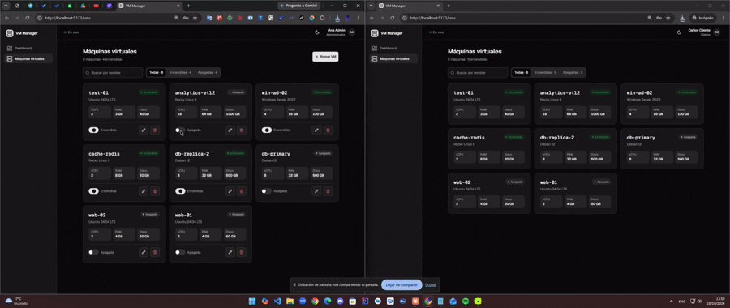
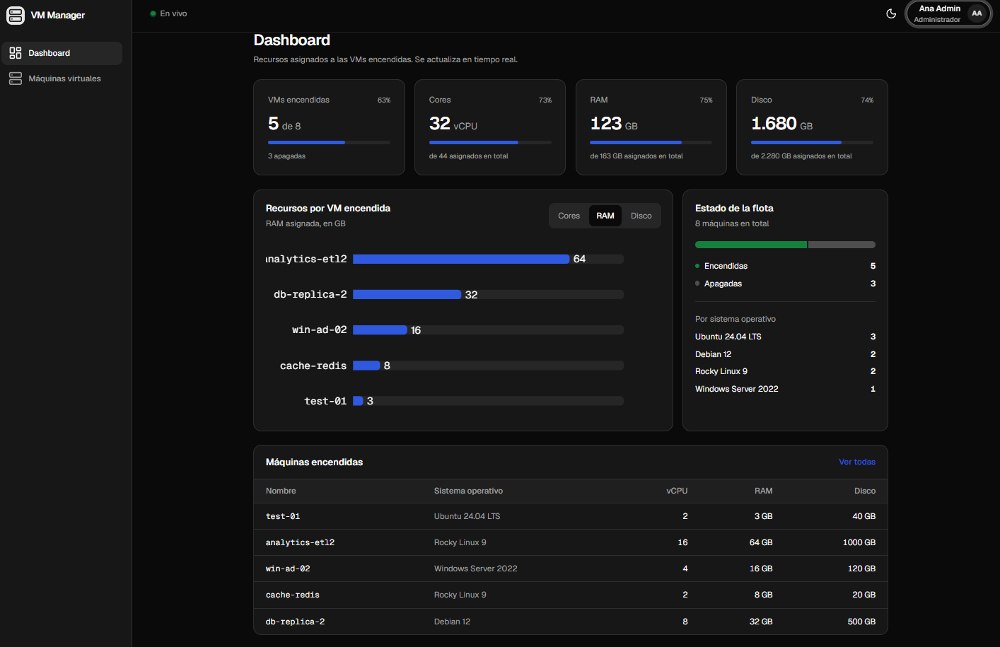
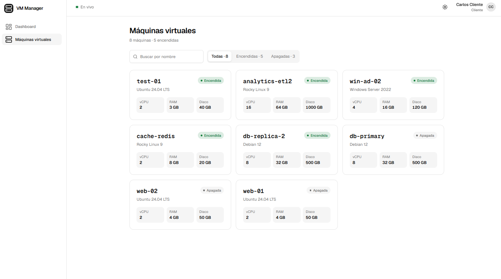
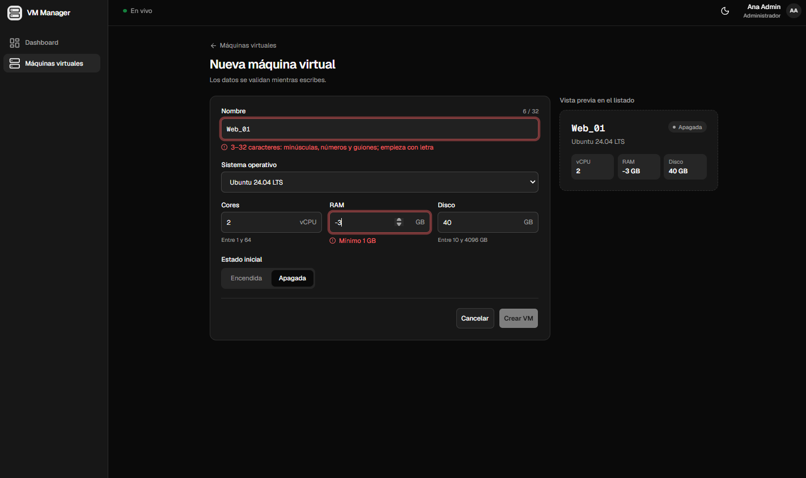
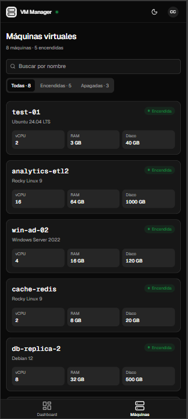
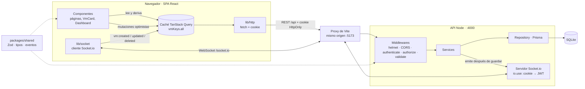
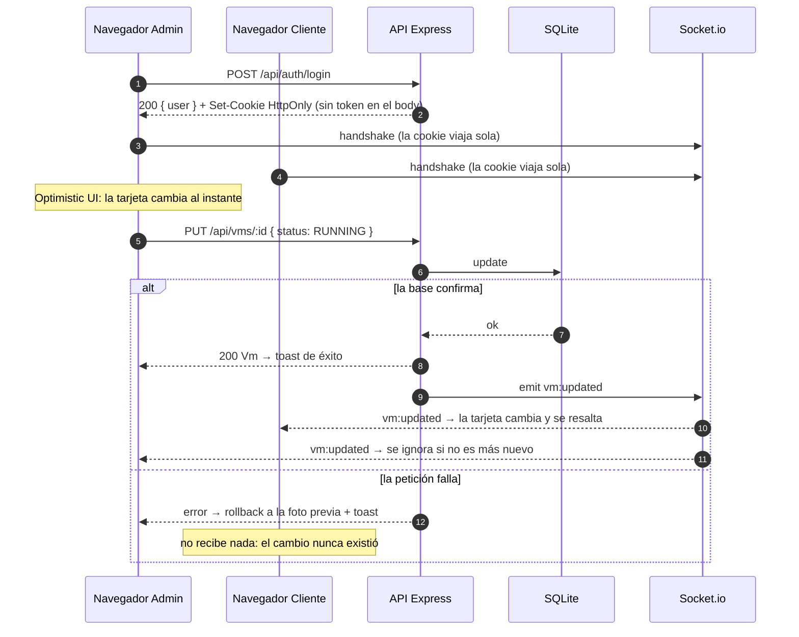

# VM Manager — Prueba Técnica Full Stack (IFX)

[](https://github.com/JmeOX/vm-manager/actions/workflows/ci.yml)

SPA para gestionar máquinas virtuales con roles (Administrador / Cliente), Optimistic UI y actualizaciones en tiempo real, más una API REST de soporte con autenticación por cookie HttpOnly.



| Dashboard (oscuro)                                | Listado como Cliente (claro)                                  | Validación en tiempo real                           | Móvil                                 |
| ------------------------------------------------- | ------------------------------------------------------------- | --------------------------------------------------- | ------------------------------------- |
|  |  |  |  |

**Contenido:** [Características](#características) · [Inicio rápido](#inicio-rápido) · [Credenciales](#credenciales-de-prueba) · [Cómo probar](#cómo-probar-lo-importante) · [API](#probar-la-api) · [Arquitectura](#arquitectura) · [Decisiones](#decisiones-arquitectónicas) · [Seguridad](#seguridad) · [Testing](#testing) · [Bitácora de IA](#bitácora-de-ia)

---

## Características

### Frontend

- [x] **SPA en React** (Vite + TypeScript) con arquitectura por _features_.
- [x] **Estética moderna y Dark Mode nativo**: tema claro / oscuro / sistema, sin destello al recargar; diseño responsive (escritorio y móvil) basado en un mockup previo.
- [x] **Optimistic UI con rollback**: crear, editar, encender/apagar y eliminar se reflejan al instante y se revierten con un toast si la API falla (demostrable con el modo "Simular fallos").
- [x] **Visualización de datos**: dashboard con la suma de Cores, RAM y Disco de las VMs encendidas, gráfico de barras (Recharts) por VM y estado de la flota.
- [x] **Feedback visual**: skeletons con la forma real del contenido, toasts de éxito/error y _empty states_ (sin datos, sin resultados, error con reintento).
- [x] **Ruta pública**: Login.
- [x] **Rutas privadas protegidas**: Dashboard, listado, creación y edición de VMs. Si el usuario es **Cliente**, los botones de crear, editar, eliminar y encender **no existen en el DOM**; las rutas de creación/edición lo redirigen.
- [x] **Formulario con validación en tiempo real** (formato del nombre, rangos de cores/RAM/disco, nombre no repetido) usando los mismos esquemas que la API.
- [x] **Tiempo real (plus)**: Socket.io autenticado; cuando un Admin cambia una VM, la tarjeta se actualiza en todas las pantallas conectadas con una animación de resaltado. Indicador de conexión "En vivo".

### Backend

- [x] **JWT en cookie `HttpOnly`, `Secure`, `SameSite=Strict`**; `POST /api/auth/login` devuelve solo el usuario y su rol (nunca el token).
- [x] **CRUD de VMs protegido por middleware JWT** con autorización por rol (Admin escribe, Cliente solo lee).
- [x] Buenas prácticas: validación con Zod en el servidor, errores uniformes, `helmet`, CORS restringido, rate limit en el login, variables de entorno validadas al arrancar.
- [x] **Tests de integración** (Vitest + Supertest) de seguridad, roles, validación y CRUD.

---

## Inicio rápido

### Requisitos

- Node.js 20 o superior (incluye npm 10)
- Git
- Windows: clona el repo fuera de OneDrive y en una ruta sin tildes (Ej. C:\dev). OneDrive bloquea archivos de node_modules y la instalación falla con EPERM

### Pasos

```bash
# 1. Instalar dependencias de todo el monorepo (también genera el cliente de Prisma)
npm install

# 2. Crear el archivo de variables de entorno de la API
cp apps/api/.env.example apps/api/.env
#    (en Windows PowerShell: Copy-Item apps/api/.env.example apps/api/.env)
#    y reemplazar JWT_SECRET por un texto aleatorio de 32+ caracteres:
#    node -e "console.log(require('crypto').randomBytes(48).toString('hex'))"
#    SIMULATED_LATENCY_MS (opcional) agrega un retraso artificial en /api/vms para ver la Optimistic UI; 0 lo desactiva

# 3. Crear la base de datos SQLite, aplicar migraciones y cargar datos de prueba
npm run db:setup -w apps/api

# 4. Levantar API (puerto 4000) y frontend (puerto 5173) con un solo comando
npm run dev
```

Abrir **http://localhost:5173**. El frontend llama a la API a través del proxy de Vite, así que el navegador solo habla con `localhost:5173`.

Otros comandos desde la raíz:

| Comando                   | Qué hace                                    |
| ------------------------- | ------------------------------------------- |
| `npm run dev`             | API + frontend en paralelo (`concurrently`) |
| `npm test`                | Tests de todos los paquetes                 |
| `npm run typecheck`       | Chequeo de tipos de todos los paquetes      |
| `npm run dev -w apps/api` | Solo la API                                 |

---

## Credenciales de prueba

Creadas por el seed (`apps/api/prisma/seed.ts`):

| Rol           | Email              | Contraseña    |
| ------------- | ------------------ | ------------- |
| Administrador | `admin@ifx.test`   | `Admin123!`   |
| Cliente       | `cliente@ifx.test` | `Cliente123!` |

---

## Cómo probar lo importante

Ideal con **dos sesiones a la vez**: una ventana normal del navegador (Administrador) y una ventana de **incógnito** (Cliente). Dos pestañas de la misma ventana no sirven: comparten la cookie de sesión.

1. **Roles:** como Cliente no hay botones de crear, editar, eliminar ni encender (buscar "Eliminar" en DevTools → Elements da 0 resultados). Ir a `/vms/new` a mano redirige al listado.
2. **Tiempo real:** el Admin apaga una VM en `/vms`; en la ventana del Cliente la tarjeta cambia y se resalta sin recargar. El Dashboard del Cliente actualiza sus totales y el gráfico.
3. **Optimistic UI y rollback:** el Admin activa **Simular fallos (dev)** en su menú de usuario e intenta apagar o eliminar una VM: el cambio aparece al instante y a los ~800 ms se revierte con un toast de error. En la ventana del Cliente no pasa nada (el servidor nunca guardó el cambio).
4. **Creación optimista:** el Admin crea una VM; aparece primera, semitransparente con "Guardando…", y luego se confirma. En el Cliente aparece resaltada.
5. **Validación en tiempo real:** en "Nueva VM", escribir `Web_01` o una RAM de `-4` muestra el error al instante y deshabilita el botón.
6. **Sesión segura:** recargar con `F5` mantiene la sesión; en DevTools → Application, `Local Storage` no tiene tokens y la cookie `vm_session` aparece marcada como `HttpOnly`.
7. **Skeletons:** gracias a la latencia simulada de 800 ms, al entrar a `/vms` o al Dashboard se ven los skeletons.
8. **Responsive:** en modo dispositivo móvil, la barra lateral se convierte en barra inferior.

---

## Probar la API

La carpeta [`apps/api/http/`](apps/api/http/) contiene colecciones de peticiones listas para ejecutar con la extensión [REST Client](https://marketplace.visualstudio.com/items?itemName=humao.rest-client) de VS Code, una por módulo:

- [`auth.http`](apps/api/http/auth.http): health, login (éxito, credenciales inválidas, validación), sesión, logout y CORS.
- [`vms.http`](apps/api/http/vms.http): CRUD de VMs y permisos por rol (`200`, `201`, `204`, `400`, `403`, `404`, `409`).

Cada archivo incluye su propio login, porque REST Client no comparte variables entre archivos.

> **Nota:** la cookie de sesión es `Secure`. Los navegadores aceptan cookies `Secure` en `http://localhost`, pero REST Client no las reenvía por HTTP. Por eso en los archivos `.http` la cookie del login se envía manualmente con `Cookie: {{login.response.headers.Set-Cookie}}`.

### Endpoints

| Método y ruta           | Acceso         | Respuesta                                                 |
| ----------------------- | -------------- | --------------------------------------------------------- |
| `GET /api/health`       | Público        | `200 { status }`                                          |
| `POST /api/auth/login`  | Público        | `200 { user }` + cookie HttpOnly · `400` · `401` · `429`  |
| `GET /api/auth/me`      | Autenticado    | `200 { user }` · `401`                                    |
| `POST /api/auth/logout` | Público        | `204` + cookie eliminada                                  |
| `GET /api/vms`          | Admin, Cliente | `200 Vm[]` · `401`                                        |
| `POST /api/vms`         | Admin          | `201 Vm` · `400` · `401` · `403` · `409` nombre duplicado |
| `PUT /api/vms/:id`      | Admin          | `200 Vm` · `400` · `401` · `403` · `404` · `409`          |
| `DELETE /api/vms/:id`   | Admin          | `204` · `400` · `401` · `403` · `404`                     |

### Eventos en tiempo real (Socket.io)

El servidor de sockets comparte puerto con la API (`http://localhost:4000`, ruta `/socket.io`). Solo acepta conexiones con una cookie de sesión válida.

| Evento (servidor → clientes) | Payload  | Se emite cuando                                  |
| ---------------------------- | -------- | ------------------------------------------------ |
| `vm:created`                 | `Vm`     | Se crea una VM (después de guardarla en la base) |
| `vm:updated`                 | `Vm`     | Se actualiza una VM (después de guardarla)       |
| `vm:deleted`                 | `{ id }` | Se elimina una VM (después de borrarla)          |

Los eventos están tipados en [`packages/shared/src/socket-events.ts`](packages/shared/src/socket-events.ts) y los usan tanto el servidor como el cliente.

### Probar el tiempo real sin frontend

```bash
# Terminal 1
npm run dev -w apps/api

# Terminal 2: inicia sesión como Cliente, abre el socket e imprime cada evento recibido
npm run socket:probe -w apps/api

# Sin cookie, la conexión se rechaza (UNAUTHENTICATED)
npm run socket:probe -w apps/api -- --sin-cookie
```

Con la sonda abierta, ejecuta las peticiones de [`vms.http`](apps/api/http/vms.http) (crear, encender, eliminar): cada cambio aparece al instante en la terminal 2. Una petición que falla (p. ej. `409`) no emite evento.

### Modo demostración (solo en desarrollo)

Para que la Optimistic UI y su rollback se puedan ver en local, las rutas `/api/vms` pasan por el middleware [`devSimulation`](apps/api/src/middleware/dev-simulation.ts), activo **solo** con `NODE_ENV=development`:

- **Latencia:** cada petición espera `SIMULATED_LATENCY_MS` (por defecto 800 ms en `.env.example`).
- **Fallo a pedido:** una petición de escritura con el header `x-simulate-failure: 1` responde `503 SIMULATED_FAILURE` sin modificar la base.

Todos los errores siguen el formato `{ "error": { "code", "message", "details"? } }`. En errores de validación, `details` es una lista `[{ "field", "message" }]` que el frontend muestra bajo cada campo.

---

## Arquitectura

### Componentes: Cliente, API y servicio de tiempo real



- El navegador **solo habla con `localhost:5173`**; el proxy de Vite reenvía `/api` y `/socket.io` a la API. Así la cookie `SameSite=Strict` viaja tanto en las peticiones REST como en el handshake del socket.
- La caché de TanStack Query es la **única fuente de verdad** de las VMs, con tres escritores: la carga inicial, las mutaciones optimistas y los eventos del socket. Listado, filtros y dashboard la leen y derivan lo que necesitan.

### Secuencia: login, cambio optimista y tiempo real



### Diseño previo

Antes de escribir componentes se diseñó un mockup de escritorio y móvil (pantallas, estados y diferencias Admin/Cliente): [`design/VM Manager — Mockups.html`](design/) (abrir en el navegador).

### Estructura del monorepo

```
vm-manager/
├─ apps/
│  ├─ api/            # API REST (Express 5 + Prisma + SQLite)
│  │  ├─ http/        # Colecciones de peticiones (REST Client)
│  │  ├─ prisma/      # schema.prisma, migraciones y seed
│  │  ├─ scripts/     # socket-probe.ts: prueba el tiempo real desde la terminal
│  │  └─ src/
│  │     ├─ config/       # Variables de entorno validadas
│  │     ├─ lib/          # Prisma client, HttpError, sesión (JWT + cookie)
│  │     ├─ middleware/   # authenticate, authorize, validate, rate-limit, devSimulation, errorHandler
│  │     ├─ modules/
│  │     │  ├─ auth/      # routes → controller → service
│  │     │  └─ vms/       # routes → controller → service → repository
│  │     ├─ realtime/     # Servidor Socket.io: autenticación del handshake y emisión de eventos
│  │     ├─ app.ts        # Construye la app de Express (sin abrir puerto; usada por los tests)
│  │     └─ server.ts     # Crea el servidor HTTP, monta Socket.io y abre el puerto
│  └─ web/            # SPA (React + Vite + Tailwind + shadcn/ui)
└─ packages/
   └─ shared/         # Esquemas Zod y tipos compartidos entre front y back
```

### Estructura del frontend

El frontend se organiza **por funcionalidad** (_feature_), no por tipo de archivo: todo lo de las VMs vive junto, y cada feature puede crecer sin tocar las demás.

```
apps/web/src/
├─ app/                 # Arranque: router, queryClient, ThemeProvider
├─ components/
│  ├─ ui/               # Componentes de shadcn/ui (generados, adaptables)
│  ├─ layout/           # AppShell (barra lateral / barra inferior), UserMenu
│  └─ *.tsx             # Compartidos: PageHeader, EmptyState, ThemeToggle, FullScreenLoader
├─ features/
│  ├─ auth/             # auth.api, useSession/useLogin/useLogout, LoginPage, guardias (Protected/RequireRole), Can
│  ├─ dashboard/        # DashboardPage, useResourceTotals (derivado), StatTile, ResourceChart, FleetStatus, tabla
│  └─ vms/              # vms.api, vms.queries (vmKeys), vms.mutations (optimistas), useVmRealtime,
│                       # filtros en URL, VmListPage, VmFormPage y componentes (VmCard, VmForm, StatusBadge…)
├─ stores/              # Zustand: dev-store (simular fallos), highlight-store (resaltado), realtime-store (conexión)
└─ lib/                 # http (fetch + ApiError), socket (cliente Socket.io tipado), utilidades
```

Dentro de cada feature: `*.api.ts` solo habla con la API (sin React), `*.queries.ts` / `use-*.ts` envuelven esas llamadas en hooks de TanStack Query, y los componentes solo consumen hooks.

### Manejo de estado

No se eligió "un gestor de estado": se clasificó el estado y cada tipo usa la herramienta adecuada.

| Tipo de estado                    | Ejemplos                                                   | Herramienta                                                                                                                |
| --------------------------------- | ---------------------------------------------------------- | -------------------------------------------------------------------------------------------------------------------------- |
| Del servidor (su dueño es la API) | Sesión (`/me`), lista de VMs                               | **TanStack Query**: caché global, carga, errores, invalidación y Optimistic UI con rollback                                |
| Global del cliente                | "Simular fallos", VMs resaltadas en vivo                   | **Zustand**: selectores (solo re-renderiza quien lee ese valor) y lectura fuera de React (`getState()` en el cliente HTTP) |
| En la URL                         | Búsqueda y filtro por estado (`/vms?status=RUNNING&q=web`) | `useSearchParams`, validado: sobrevive al recargar y se puede compartir                                                    |
| De formulario                     | Login, crear/editar VM                                     | **React Hook Form** + `zodResolver` con los esquemas de `packages/shared`                                                  |
| Local                             | Diálogos abiertos                                          | `useState`                                                                                                                 |

La sesión no está en un store: es estado del servidor (la cookie HttpOnly solo la puede validar la API), así que vive en TanStack Query y se rehidrata con `GET /api/auth/me`.

---

## Decisiones arquitectónicas

| Decisión                                                                                                         | Alternativa descartada                           | Motivo                                                                                                                                                                                                                                                         |
| ---------------------------------------------------------------------------------------------------------------- | ------------------------------------------------ | -------------------------------------------------------------------------------------------------------------------------------------------------------------------------------------------------------------------------------------------------------------- |
| Monorepo con npm workspaces                                                                                      | Repos separados                                  | Las reglas de validación y los tipos (`packages/shared`) se escriben una vez y los usan front y back; un solo `npm install` para revisar                                                                                                                       |
| Esquemas Zod compartidos                                                                                         | Validar por separado en cada lado                | El formulario y la API aplican exactamente las mismas reglas; los tipos TypeScript se derivan del esquema                                                                                                                                                      |
| Express 5                                                                                                        | Express 4                                        | Captura automática de errores en handlers `async`, sin `try/catch` repetidos                                                                                                                                                                                   |
| Prisma 6 + SQLite                                                                                                | PostgreSQL                                       | Cero instalación para el revisor. Migrar a PostgreSQL = cambiar `provider` y `DATABASE_URL` y regenerar migraciones; el código de la API no cambia                                                                                                             |
| `role`, `os`, `status` como `String` en BD                                                                       | Enums de BD                                      | SQLite no tiene enums nativos; la integridad la garantizan los esquemas Zod antes de guardar                                                                                                                                                                   |
| Variables de entorno validadas con Zod al arrancar                                                               | Leer `process.env` directo                       | _Fail-fast_: la API no arranca si falta o es inválida una variable (p. ej. `JWT_SECRET` corto)                                                                                                                                                                 |
| `app.ts` (construye Express) separado de `server.ts` (abre el puerto)                                            | Un solo `index.ts` con `app.listen`              | Los tests usan la app completa con Supertest sin levantar un servidor real                                                                                                                                                                                     |
| Capas `routes → controller → service → repository`                                                               | Lógica en las rutas                              | Cada capa tiene una responsabilidad: rutas y middlewares / HTTP / reglas de negocio / acceso a datos. El service no conoce HTTP ni Prisma, así que se reutiliza (p. ej. para emitir eventos de Socket.io) y el ORM se puede cambiar tocando solo el repository |
| Orden de middlewares: `authenticate → authorize → validate → controller`                                         | Validar antes de autorizar                       | Un Cliente recibe `403` sin importar el body enviado; no se revelan las reglas de validación a quien no tiene permiso                                                                                                                                          |
| Errores de unicidad detectados por el código Prisma `P2002`                                                      | Consultar si el nombre existe antes de guardar   | Evita condiciones de carrera entre dos creaciones simultáneas; se traduce a `409` con `details` en el campo `name`                                                                                                                                             |
| `PUT /api/vms/:id` acepta actualizaciones parciales                                                              | `PATCH`                                          | El enunciado define `PUT`; permitir campos parciales simplifica acciones como encender/apagar (`{ "status": "RUNNING" }`). Un body vacío se rechaza con `400`                                                                                                  |
| Socket.io sobre el mismo servidor HTTP que Express (`createServer(app)`)                                         | Un servicio de tiempo real aparte                | Un solo puerto y un solo origen: la cookie de sesión viaja también en el handshake del socket, sin configuración extra                                                                                                                                         |
| Eventos emitidos desde el service **después** de confirmar en la base                                            | Emitir antes de guardar, o desde el controller   | Si la base falla (p. ej. nombre duplicado), ningún cliente recibe un cambio que nunca existió. Al estar en el service, la emisión ocurre igual sin importar quién invoque la operación                                                                         |
| Eventos de socket tipados en `packages/shared`                                                                   | Nombres de evento como strings sueltos           | Un error de tipeo en el nombre o en el payload no compila, ni en el servidor ni en el cliente                                                                                                                                                                  |
| Middleware `devSimulation` (solo desarrollo): latencia configurable y fallo a pedido con `x-simulate-failure: 1` | Probar el rollback apagando la API               | Hace visibles la Optimistic UI y el rollback en local, donde la API responde en milisegundos y nunca falla. No tiene efecto en producción ni en tests                                                                                                          |
| Lógica del JWT centralizada en `lib/session.ts`                                                                  | Firmar y verificar en cada lugar que lo necesite | Login, middleware REST y el handshake del socket usan las mismas funciones y opciones de cookie                                                                                                                                                                |

### Frontend

| Decisión                                                                              | Alternativa descartada                                  | Motivo                                                                                                                                                                                                                                       |
| ------------------------------------------------------------------------------------- | ------------------------------------------------------- | -------------------------------------------------------------------------------------------------------------------------------------------------------------------------------------------------------------------------------------------- |
| SPA con Vite + React + TypeScript                                                     | Next.js                                                 | El enunciado pide una SPA; el renderizado en servidor de Next no aporta aquí y agrega complejidad. Vite arranca al instante                                                                                                                  |
| Proxy de Vite para `/api` y `/socket.io`                                              | Llamar directo a `localhost:4000` con CORS              | El navegador ve un **solo origen**: la cookie `SameSite=Strict` viaja sin configuración extra y no hay peticiones _cross-site_                                                                                                               |
| Tailwind CSS v4 + shadcn/ui (estilo Vega, primitivas Radix UI)                        | Librería de componentes cerrada (MUI, Chakra)           | Los componentes se copian al proyecto y se adaptan; Radix aporta accesibilidad (teclado, foco, ARIA). Se mantuvieron las rutas por defecto de shadcn (`components/ui`, `lib`) para no pelear con la herramienta                              |
| Tema claro/oscuro/sistema con script en `index.html`                                  | Aplicar el tema solo desde React                        | El script aplica la clase `dark` antes del primer pintado: no hay destello claro al recargar en modo oscuro. La preferencia (no sensible) se guarda en `localStorage`                                                                        |
| Socket.io escribe en la **misma caché** de TanStack Query que la API y las mutaciones | Mantener una lista aparte para los eventos              | Una sola fuente de verdad: listado, filtros y dashboard se actualizan solos. Se ignoran eventos con `updatedAt` más antiguo y se evita duplicar la VM que el propio Admin creó (el evento puede llegar antes o después de la respuesta HTTP) |
| Totales del dashboard **derivados** de la lista (`useMemo`)                           | Guardarlos en un estado o pedirlos a un endpoint aparte | No hay nada que sincronizar: cambian solos con la Optimistic UI y con el socket                                                                                                                                                              |
| Animación de resaltado con CSS (Tailwind + `tw-animate-css`)                          | Framer Motion                                           | Una dependencia menos para una animación simple; respeta `prefers-reduced-motion` con `motion-safe:`                                                                                                                                         |
| Formulario con React Hook Form + el esquema compartido + regla local de nombre único  | Validar solo al enviar                                  | Errores mientras se escribe con las mismas reglas que la API; el nombre repetido se detecta antes del `409`, que queda como red de seguridad                                                                                                 |
| Tipografía Geist / Geist Mono (`@fontsource`)                                         | Fuentes del sistema o CDN                               | Fidelidad con el mockup; fuentes servidas localmente, sin dependencia de terceros en tiempo de ejecución                                                                                                                                     |
| Mockup previo (escritorio y móvil)                                                    | Diseñar mientras se programa                            | Define pantallas, componentes, estados (carga, vacío, error, optimista, en vivo) y la diferencia Admin/Cliente antes de escribir código                                                                                                      |

---

## Seguridad

- JWT firmado (HS256) enviado **solo** en cookie `HttpOnly`, `Secure`, `SameSite=Strict`. El body del login devuelve únicamente el usuario y su rol; el frontend nunca ve ni guarda el token.
- `GET /api/auth/me` permite al frontend recuperar la sesión al recargar, ya que no puede leer la cookie.
- Contraseñas almacenadas como hash con bcrypt (costo 10); nunca en texto plano.
- Mensaje de login genérico ("Credenciales inválidas") y comparación contra un hash ficticio cuando el email no existe, para no revelar qué cuentas existen.
- `jwt.verify` restringido al algoritmo `HS256`.
- Validación de todos los bodies en el servidor con Zod; errores con formato uniforme `{ error: { code, message, details? } }`.
- En producción, los errores 500 no exponen detalles internos.
- `.env` fuera del repositorio; `.env.example` documenta las variables.

- Autorización por rol en cada endpoint de escritura (`authorize('ADMIN')` → `403` para Cliente). Ocultar botones en el frontend es UX; la seguridad real está en el backend.
- `401` (sin sesión o sesión inválida) diferenciado de `403` (sesión válida sin permiso).
- `helmet` para cabeceras de seguridad (CSP, `nosniff`, frameguard) y para ocultar `X-Powered-By`.
- CORS restringido a `CLIENT_ORIGIN` con `credentials: true`; nunca `*`.
- Límite de 5 intentos fallidos de login por minuto por IP (`express-rate-limit`), con respuesta `429` en el formato de error estándar. Los logins exitosos no cuentan.
- Parámetros de URL validados (`:id` debe ser UUID) antes de consultar la base.
- Bodies JSON limitados a 10 KB.

- Socket.io autenticado: un middleware (`io.use`) lee la cookie `vm_session` del handshake y la verifica con la misma función que la API REST. Sin sesión válida, la conexión se rechaza y no se reciben datos de VMs.
- CORS del socket restringido a `CLIENT_ORIGIN`.

---

## Testing

### API

Tests de integración con [Vitest](https://vitest.dev/) y [Supertest](https://github.com/ladjs/supertest): hacen peticiones reales a la app de Express (sin abrir puerto) contra una base SQLite separada (`apps/api/prisma/test.db`), que se recrea con migraciones y seed antes de cada ejecución. La base de desarrollo no se toca.

```bash
npm test -w apps/api          # una ejecución
npm run test:watch -w apps/api # modo observación
```

Cubren los requisitos que evalúa el enunciado:

| Archivo                                       | Qué verifica                                                                                                                                                                                                                                                      |
| --------------------------------------------- | ----------------------------------------------------------------------------------------------------------------------------------------------------------------------------------------------------------------------------------------------------------------- |
| [`auth.test.ts`](apps/api/tests/auth.test.ts) | Login devuelve usuario y rol **sin token en el body**; cookie con `HttpOnly`, `Secure` y `SameSite=Strict`; nunca expone `passwordHash`; `401` genérico con credenciales inválidas; `400` con detalle por campo; `/me` con y sin sesión; token manipulado → `401` |
| [`vms.test.ts`](apps/api/tests/vms.test.ts)   | `401` sin sesión; el Cliente lista pero recibe `403` al crear, actualizar o eliminar; CRUD completo del Admin; `409` por nombre duplicado (señalando el campo); `400` por RAM negativa, nombre inválido, body vacío o id no UUID; `404` si la VM no existe        |

En `NODE_ENV=test` se desactivan el rate limit y el modo demostración.

### Tests automáticos vs. colecciones `.http`

Los tests verifican automáticamente que nada se rompa (localmente y en CI). Las colecciones de [`apps/api/http/`](apps/api/http/) sirven para explorar la API a mano, ver headers y tiempos de respuesta, probar el modo demostración y disparar eventos mientras corre la sonda del socket.

### Frontend

Tests con Vitest + [Testing Library](https://testing-library.com/) (jsdom). La API se reemplaza por _mocks_, así que corren sin servidor y en milisegundos.

```bash
npm test -w apps/web
```

| Archivo                                                                      | Qué verifica                                                                                                                                                                                                               |
| ---------------------------------------------------------------------------- | -------------------------------------------------------------------------------------------------------------------------------------------------------------------------------------------------------------------------- |
| [`vms.mutations.test.tsx`](apps/web/src/features/vms/vms.mutations.test.tsx) | **Optimistic UI**: encender cambia la caché antes de que responda el servidor y se **revierte** si la API falla (con toast de error); se mantiene si confirma; eliminar quita la VM al instante y la **restaura** si falla |
| [`can.test.tsx`](apps/web/src/features/auth/can.test.tsx)                    | Para el **Cliente** el botón protegido **no existe en el DOM**; el Admin sí lo ve                                                                                                                                          |
| [`vm-form.test.tsx`](apps/web/src/features/vms/components/vm-form.test.tsx)  | **Validación en tiempo real**: formato de nombre, nombre repetido, RAM negativa; el botón se habilita solo con datos válidos                                                                                               |

### Integración continua

[GitHub Actions](.github/workflows/ci.yml) ejecuta en cada push a `main`, desde una máquina limpia: `npm ci` → chequeo de tipos de los tres paquetes → todos los tests (API + frontend).

---

## Limitaciones y siguientes pasos

- **VMs sin propietario:** todos los clientes ven todas las VMs (como define `GET /vms` en el enunciado). En un sistema real cada VM pertenecería a un cliente y el listado se filtraría por propietario.
- **Sin paginación:** el listado trae todas las VMs; suficiente para decenas, no para miles (siguiente paso: paginación por cursor + búsqueda en el servidor).
- **Porcentajes del dashboard:** son relativos a los recursos **asignados** a todas las VMs, no a la capacidad física de un host (no hay ese dato en el modelo).
- **Sin pruebas end-to-end ni despliegue público:** siguientes pasos naturales: un flujo con Playwright y un despliegue en un solo servicio (Express sirviendo el build del front, para mantener el mismo origen y la cookie `SameSite=Strict`).

- **Rate limit en memoria:** el contador vive en el proceso; se reinicia al reiniciar la API y no se comparte entre varias instancias. En producción se usaría un store compartido (p. ej. Redis).
- **Logout con JWT stateless:** el logout elimina la cookie del navegador, pero el token sigue siendo válido hasta su expiración (8 h), porque el servidor no guarda sesiones. Mitigaciones posibles: expiración corta con _refresh tokens_, o una lista de tokens revocados (Redis / BD).

---

## Bitácora de IA

### Herramientas utilizadas

- **Claude (Anthropic)**, en modo conversacional, como guía técnica y par de programación: plan del proyecto, revisión de arquitectura, primera versión del código de cada paso (que yo integraba, ejecutaba y verificaba), mockups de escritorio y móvil, y borradores de esta documentación.
- **VS Code + REST Client** para probar la API a mano, **Chrome DevTools** para verificar cookies, red, accesibilidad y modo móvil.
- Las convenciones que seguí al trabajar con la IA están en [`AGENTS.md`](AGENTS.md).

### Qué delegué y dónde intervine

Trabajé por pasos pequeños: para cada uno pedí qué problema resolvía y si era obligatorio o un extra, y no avancé hasta comprobarlo funcionando (con `.http`, DevTools o tests).

**Delegué** el andamiaje y el código repetitivo (configuración, componentes de shadcn, primeras versiones de servicios, componentes y tests) y los borradores de documentación.

**Intervine** en estas decisiones y correcciones:

- **Herramientas:** cambié pnpm por npm workspaces para que el revisor no necesite instalar nada extra.
- **Diseño antes de código:** antes de crear componentes pedí un mockup completo, y luego también la versión móvil. De ahí salieron el inventario de componentes, los estados (carga, vacío, error, optimista, en vivo) y la navegación móvil con barra inferior.
- **Manejo de estado:** cuestioné por qué no usar Zustand si el enunciado evalúa "estado global". El resultado fue clasificar el estado (servidor → TanStack Query, cliente → Zustand, URL, formularios) y usar Zustand solo donde hay un motivo concreto (leerlo fuera de React y suscripciones por id).
- **Sobreingeniería:** pedí distinguir lo obligatorio de lo extra; la capa _repository_ y el hash ficticio contra _timing attacks_ quedaron como decisiones conscientes y documentadas.
- **Depuración:** `GET /me` respondía `401` en REST Client. La causa era que la cookie `Secure` no se reenvía por HTTP fuera del navegador. Lo resolví enviando la cookie de forma explícita, y documenté la limitación del logout con JWT _stateless_.
- **Datos de prueba:** un `409` inesperado por una VM que quedó de una prueba anterior llevó a usar nombres aleatorios en las colecciones `.http`. Separé las colecciones por módulo y las mantuve junto a los tests porque cumplen otro propósito (exploración manual y demostración).
- **UI:** detecté que el desplegable de sistema operativo se veía blanco en modo oscuro; se corrigió con colores explícitos en las opciones y `color-scheme: dark`.
- **Verificar a la IA:** la IA sugirió desinstalar el paquete `cn` por considerarlo ajeno; al revisar los imports comprobé que es el paquete oficial de shadcn y se mantuvo. Desde entonces, ninguna dependencia se quita sin verificar su origen y quién la usa.
- **Entrega:** revisión de secretos antes del primer push y CI para garantizar que el proyecto funciona en una máquina limpia.
